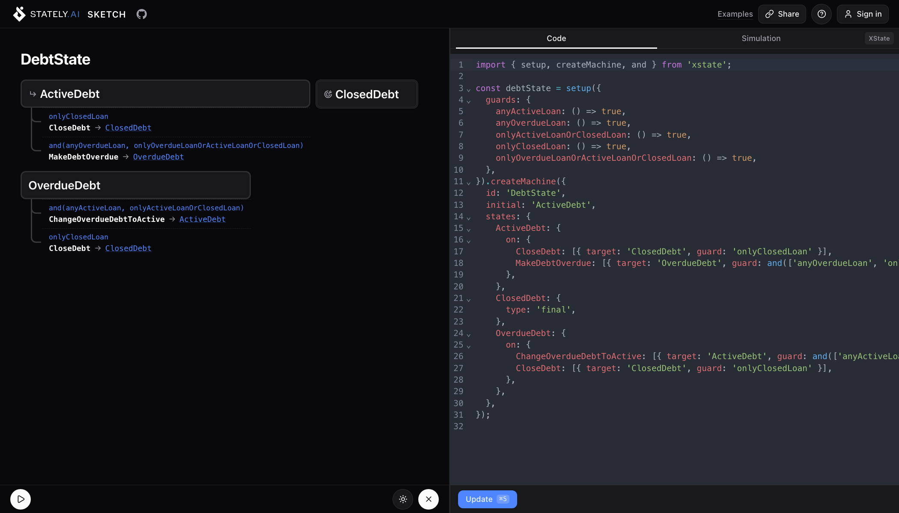

# invariants

[](https://pypi.org/project/invariants/)
[](https://pypi.org/project/invariants/)
[](https://github.com/nkhitrov/invariants/blob/main/LICENSE)

Type-safe state modeling for Python. Split entity invariants into separate, validated, immutable state classes using Pydantic.

## Why?

When an entity has multiple states, each state often has different field requirements. Typically, this is modeled with optional fields and runtime checks. **invariants** enforces these constraints at the type level:

- Each state is a separate class with its own field types
- A metaclass ensures child states override all abstract fields and don't add new ones
- All states are immutable and have no behaviour
- An event is a change of the business state (the state class), and every edge of the state graph has exactly one `Event` and one owner `Operation`
- Operation signatures are the state graph: mypy checks the calls, and the same annotations drive the diagram

## Installation

```bash
pip install invariants
```

## Quick Start

Define a root state with `Statefull` fields (abstract markers), then create concrete states that override them.
States keep only facts; anything derived from them (paid amounts, penalties) is computed on the fly by plain
functions — see [`examples/calculations.py`](examples/calculations.py). Denormalized values belong to separate
read models, not to states.

```python
from datetime import date
from decimal import Decimal
from typing import Annotated, Literal

from pydantic import BaseModel, ConfigDict, Field

from invariants.state import State, Statefull


class PaymentState(State):
    id: int
    amount: Decimal
    paid_at: date
    transferred_from_loan_id: int | None = None  # moved here from a cancelled restructuring
    status: Statefull


class ReceivedPayment(PaymentState):
    status: Literal["received"] = "received"


class Installment(BaseModel):  # a value object, not a state
    model_config = ConfigDict(frozen=True, strict=True)

    postponement_date: date  # overdue after this date
    amount: Decimal


class LoanState(State):
    id: int
    financed_amount: Decimal
    booking_date: date  # the day the loan terms are calculated for
    schedule: Annotated[tuple[Installment, ...], Field(min_length=1)]
    payments: tuple[ReceivedPayment, ...] = ()
    status: Statefull


class ActiveLoan(LoanState):
    status: Literal["active"] = "active"


class OverdueLoan(LoanState):
    status: Literal["overdue"] = "overdue"


class ClosedLoan(LoanState):
    status: Literal["closed"] = "closed"
```

The metaclass enforces two rules at class creation time:
1. Child states **cannot add new fields** — only override parent fields
2. Child states **must override all `Statefull` fields** with concrete types

## Operations and Events

States are plain data. A change of the business state — moving from state class `A` to state class `B` — is an
**edge** of the state graph. Each edge has exactly one **event** and exactly one **owner operation**.
A change of fields that keeps the state class (a new payment, a moved booking date) is a **loop**: it has no
event of its own.

### Events — one per edge

`Event[From, To]` is a frozen, strict Pydantic model. `From = None` is the null state (creation). The payload
is exactly the fields you declare:

```python
from invariants.operations import Event


class PaymentReceivedEvent(Event[None, ReceivedPayment]):
    payment_id: int


class LoanIssuedEvent(Event[None, ActiveLoan]):  # ∅ → ActiveLoan
    loan_id: int


class LoanBecameOverdueEvent(Event[ActiveLoan, OverdueLoan]):
    loan_id: int


class LoanOverdueCancelledEvent(Event[OverdueLoan, ActiveLoan]):
    loan_id: int


class ActiveLoanClosedEvent(Event[ActiveLoan, ClosedLoan]):
    loan_id: int


class OverdueLoanClosedEvent(Event[OverdueLoan, ClosedLoan]):
    loan_id: int
```

Checked at class creation: the name ends with `Event`, `From`/`To` are concrete states of one hierarchy,
`From ≠ To`, and no other event already describes the same edge.

### Operations — one signature per edge

An operation returns a `Transition[State, Events]` — a plain named tuple of the new state and the events:

```python
from typing import Never, overload

from examples.calculations import is_repaid, overdue_installments
from invariants.operations import Operation, Transition


class IssueLoanOperation(Operation[LoanState]):  # no state parameter: starts from the null state
    def execute(
        self, *, loan_id: int, financed_amount: Decimal, booking_date: date, schedule: tuple[Installment, ...]
    ) -> Transition[ActiveLoan, LoanIssuedEvent]:
        loan = ActiveLoan(id=loan_id, financed_amount=financed_amount, booking_date=booking_date, schedule=schedule)
        return Transition(loan, (LoanIssuedEvent(loan_id=loan_id),))


class CloseLoanOperation(Operation[LoanState]):  # several edges: one @overload per edge
    @overload
    def execute(self, loan: ActiveLoan) -> Transition[ClosedLoan, ActiveLoanClosedEvent]: ...
    @overload
    def execute(self, loan: OverdueLoan) -> Transition[ClosedLoan, OverdueLoanClosedEvent]: ...
    def execute(
        self, loan: ActiveLoan | OverdueLoan
    ) -> Transition[ClosedLoan, ActiveLoanClosedEvent | OverdueLoanClosedEvent]:
        if not is_repaid(loan):
            raise ValueError("the loan is not repaid with penalties")
        closed = ClosedLoan(**loan.model_dump(exclude={"status"}))
        match loan:
            case ActiveLoan():
                return Transition(closed, (ActiveLoanClosedEvent(loan_id=loan.id),))
            case OverdueLoan():
                return Transition(closed, (OverdueLoanClosedEvent(loan_id=loan.id),))


loan, issued = IssueLoanOperation().execute(
    loan_id=1,
    financed_amount=Decimal(1000),
    booking_date=date(2026, 1, 1),
    schedule=(Installment(postponement_date=date(2026, 1, 31), amount=Decimal(1000)),),
)
```

Signature rules, checked when the operation class is created:

- the class name ends with `Operation`, and `T` in `Operation[T]` is the root state;
- the first parameter is a single concrete source state (no state parameter means creation from `None`);
  all other parameters are keyword-only;
- the return type is `Transition[B, E]`, or a union of them when the target depends on data;
- for `A → B` (`A ≠ B`), `E` contains exactly one event of the root, and it is `Event[A, B]`;
- an edge is declared once per operation.

At runtime `execute` is wrapped (its signature is unchanged for mypy): returning an undeclared state or event,
or not emitting the edge event exactly once, raises `TransitionError`.

### Loops

A loop `A → A` keeps the state class: it has **no root event** (`Event[A, A]` is forbidden), may emit no events
at all (`Transition[A, Never]`), and is not an owned edge — any number of operations may have loops on the same
state. When the target depends on data, return a union of transitions:

```python
class RecalculateLoanTermsOperation(Operation[LoanState]):
    def execute(self, loan: ActiveLoan, *, booking_date: date) -> (
        Transition[OverdueLoan, LoanBecameOverdueEvent] | Transition[ActiveLoan, Never]
    ):
        moved = ActiveLoan(**loan.model_dump(exclude={"status"}) | {"booking_date": booking_date})
        if not overdue_installments(moved):
            unchanged: Transition[ActiveLoan, Never] = Transition(moved, ())  # only the date moved
            return unchanged
        overdue = OverdueLoan(**moved.model_dump(exclude={"status"}))
        return Transition(overdue, (LoanBecameOverdueEvent(loan_id=loan.id),))
```

mypy has no single context to infer the events of a union of transitions, so annotate the `Transition` in a local
variable before returning it.

### Ownership, dependencies and delegation

Operations are frozen, keyword-only, slotted dataclasses. Their fields are their dependencies — only other
`Operation`s or `Query`s; time, repository data and settings are `execute` arguments.

The first operation that declares an edge `A → B` owns it. Any other operation may declare that edge, or emit its
event (for example, an event of a nested aggregate), **only by delegating to the owner** through a dependency field,
directly or transitively. Two independent owners of one edge raise `TypeError`:

```python
class ReceivePaymentOperation(Operation[PaymentState]):
    def execute(
        self, *, payment_id: int, amount: Decimal, paid_at: date
    ) -> Transition[ReceivedPayment, PaymentReceivedEvent]:
        payment = ReceivedPayment(id=payment_id, amount=amount, paid_at=paid_at)
        return Transition(payment, (PaymentReceivedEvent(payment_id=payment_id),))


class ReceiveLoanPaymentOperation(Operation[LoanState]):
    receive_payment: ReceivePaymentOperation  # delegates the nested ∅ → ReceivedPayment edge

    def execute(
        self, loan: ActiveLoan, *, payment_id: int, amount: Decimal, paid_at: date
    ) -> Transition[ActiveLoan, PaymentReceivedEvent]:  # a loop: paying never changes the state class
        payment, events = self.receive_payment.execute(payment_id=payment_id, amount=amount, paid_at=paid_at)
        paid = ActiveLoan(**loan.model_dump(exclude={"status", "payments"}), payments=(*loan.payments, payment))
        return Transition(paid, events)


operation = ReceiveLoanPaymentOperation(receive_payment=ReceivePaymentOperation())
```

The debt example ([`examples/debt/operations.py`](examples/debt/operations.py)) composes the same way: `RecalculateDebtOperation`
delegates to the loan recalculation and penalty operations, and `ReceiveDebtPaymentOperation` pays a loan and,
once no installment is overdue, delegates `OverdueDebt → ActiveDebt` to its owner `CancelDebtOverdueOperation`.

### Example: debt restructuring

[`examples/restructuring/`](examples/restructuring) and [`examples/debt/`](examples/debt) show a nested
entity two levels deep (debt → restructuring → loans):

- The terms are approved outside the invariants and come in as a value object: `RestructuringTerms(id, loans)`, where
  each `LoanTerms` has `loan_id`, `financed_amount` and `schedule`. Each installment of a restructuring loan names
  the original loan it pays off (`Installment.original_loan_id`), so loans map 1:1 or N:M.
- `ApplyRestructuringOperation` owns `ActiveDebt → RestructuredDebt` and `OverdueDebt → RestructuredDebt`. It
  issues the new loans by delegating to `IssueLoanOperation`. `RestructuredDebt` keeps a snapshot of the original
  loans so it can roll back.
- The restructuring loans are ordinary loans. The daily recalculation and payments are loops of `RestructuredDebt`
  that work on them.
- `CancelRestructuringOperation` owns `RestructuredDebt → OverdueDebt | ActiveDebt`. The application calls it
  directly, and the daily recalculation delegates to it as soon as a restructuring loan would become overdue.
  On cancellation, payments made to the restructuring loans move to the original loans by the installment mapping.
  A moved payment (`transferred_from_loan_id`) pays the principal before the penalty. Then the original loans are
  recalculated by their own schedule, so the penalty is computed as if there had been no restructuring.
  The cancelled restructuring is dropped from the debt: the debt's edge event records the cancellation.
- `CloseDebtOperation` owns `RestructuredDebt → ClosedRestructuredDebt`. It closes the restructuring and its loans
  by delegation.

### Queries

`Query[T]` follows the same dataclass and dependency rules, but `execute` returns any value and moves nothing:

```python
from invariants.operations import Query

from examples.calculations import overdue_days


class LoanOverdueDaysQuery(Query[LoanState]):
    def execute(self, loan: OverdueLoan) -> int:
        return overdue_days(loan)
```

### Registries

Events and owned edges register in a default `EdgeRegistry`. Pass your own to isolate graphs, for example in tests:

```python
from invariants.operations import EdgeRegistry

registry = EdgeRegistry()


class LoanPaidEvent(Event[ActiveLoan, ClosedLoan], registry=registry):
    loan_id: int
```

The full example lives in [`examples/`](examples). Each aggregate — [`payment`](examples/payment),
[`loan`](examples/loan), [`restructuring`](examples/restructuring) and [`debt`](examples/debt) — is a package that keeps
invariants and operations apart: `states.py` holds the states and value objects, `events.py` the events of their
edges, and `operations.py` the operations over them. Money is computed by the pure functions of
[`calculations.py`](examples/calculations.py).

## Factories (Testing)

Optional integration with [polyfactory](https://github.com/litestar-org/polyfactory) for generating test data. The key idea: **a factory always produces a valid state** — all business invariants are satisfied automatically.

```bash
pip install invariants[factories]
```

Define factories for concrete states — the model is inferred from the generic argument:

```python
from invariants.factories import StateFactory


from examples.debt.states import ActiveDebt


class ActiveLoanFactory(StateFactory[ActiveLoan]): ...
class ClosedLoanFactory(StateFactory[ClosedLoan]): ...
class ActiveDebtFactory(StateFactory[ActiveDebt]): ...
```

When you build a nested state, child entities are generated automatically:

```python
debt = ActiveDebtFactory.build()

# loans are auto-populated with valid ActiveLoan | ClosedLoan instances
# ContainsOne(ActiveLoan) is always satisfied — at least one loan is active
assert any(isinstance(loan, ActiveLoan) for loan in debt.loans)
```

### SQLAlchemy Integration

`SQLAlchemyStateFactory` maps Pydantic states to ORM models — `build()` returns ORM instances instead of Pydantic models:

```python
from invariants.factories.sqlalchemy import SQLAlchemyStateFactory


class ActiveLoanORMFactory(SQLAlchemyStateFactory[ActiveLoan, LoanORM]): ...

loan = ActiveLoanORMFactory.build()
assert isinstance(loan, LoanORM)  # ORM instance, not Pydantic model
```

Both `StateFactory` and `SQLAlchemyStateFactory` are thin wrappers over [polyfactory](https://polyfactory.litestar.dev/) — all interfaces (sessions, persistence, batch creation) work the same as in the polyfactory docs.

## XState Visualization

Generate [XState v5](https://stately.ai/docs/xstate) state machine code from your operations. Each edge
becomes a transition named after its event, a loop becomes an internal (targetless) transition named after its
operation, and the creation edge (`None → B`) sets the initial state:

```bash
# Print generated JS — paste it into https://sketch.stately.ai
python -m invariants.viz print examples.debt.operations

# Start a local Stately Sketch with one document per state machine
# (clones https://github.com/statelyai/sketch on first run; needs Node.js with pnpm or npx)
python -m invariants.viz serve examples.debt.operations
```

`serve` opens each machine in the browser


